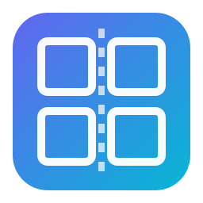
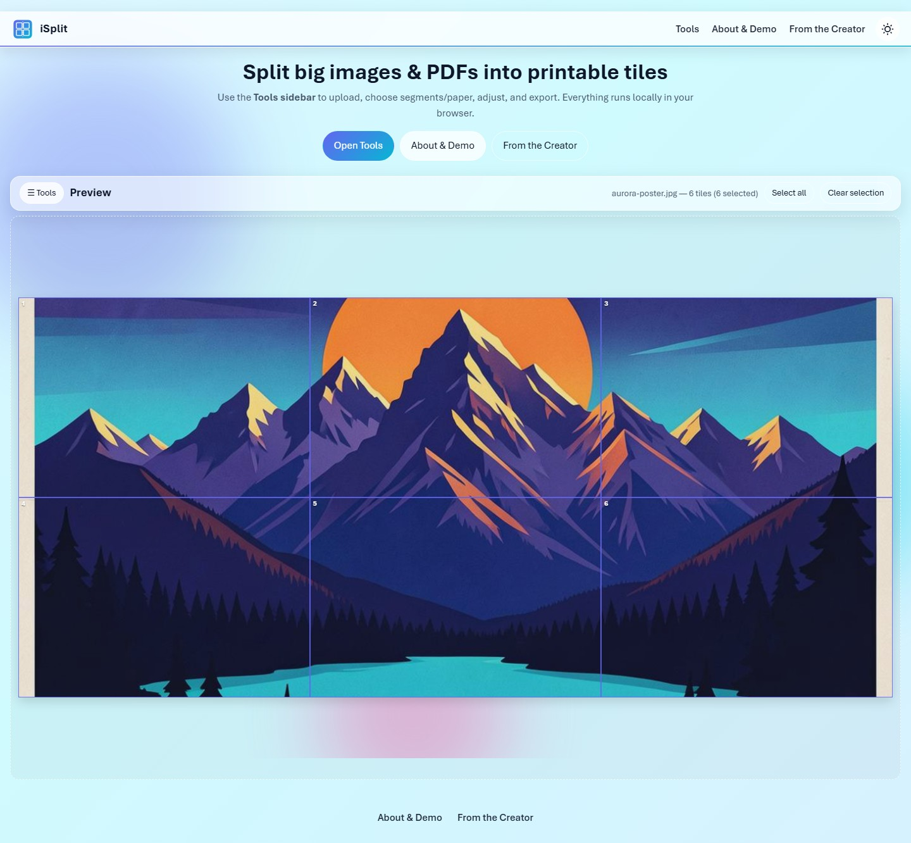
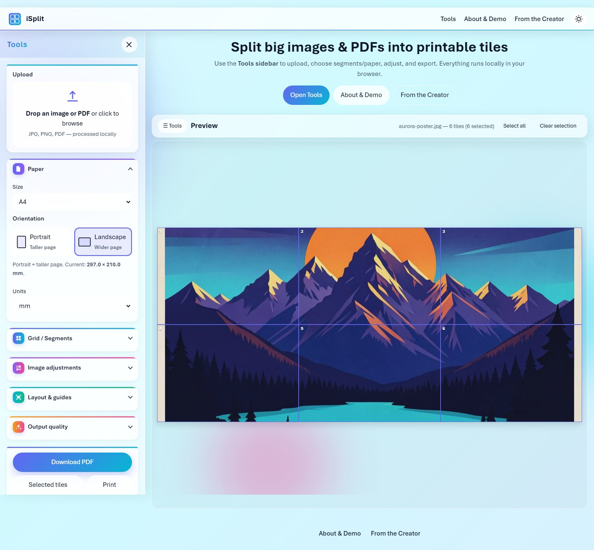
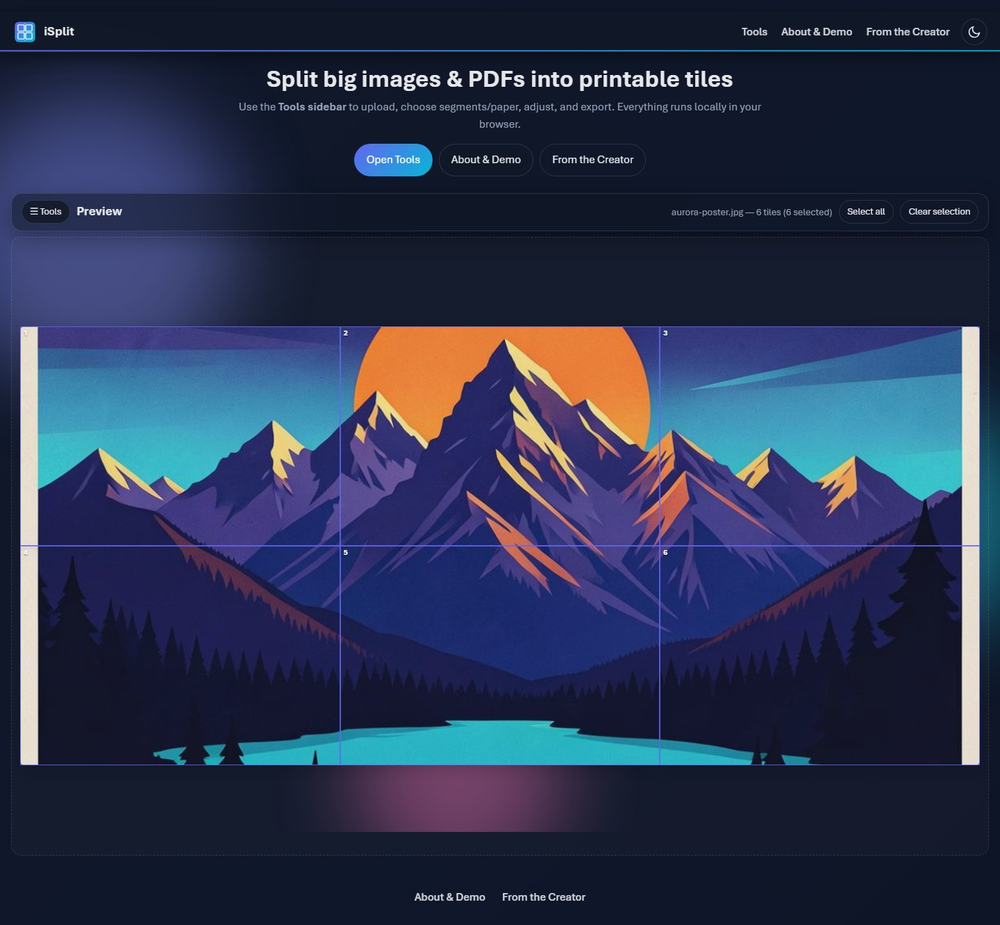
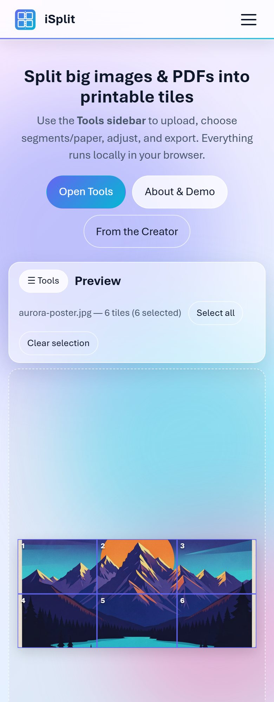

<div align="center">



# iSplit

**Split large images and PDFs into printable, paper-sized tiles.**

Turn any home printer into a poster printer. Choose your paper, preview the grid, and export a print-ready PDF — all locally in your browser.

[](https://vortexprotocol1633.github.io/iSplit/)
[](LICENSE)
[](#tech-stack)
[](SECURITY.md)
[](CONTRIBUTING.md)

**[Open iSplit →](https://vortexprotocol1633.github.io/iSplit/)** · [Features](#features) · [Quick start](#quick-start) · [Screenshots](#screenshots)

</div>

<p align="center">
  <a href="https://vortexprotocol1633.github.io/iSplit/">
    
  </a>
  <br />
  <sub>A 6-tile landscape poster previewed live. Print the pages, trim, and assemble.</sub>
</p>

## Why iSplit?

Most home printers only take A4 or Letter. iSplit lets you make the poster, map, blueprint, banner or wall art you actually want by slicing it into pages that fit, with alignment guides so the finished result joins cleanly.

- **No uploads.** Your files are read with the browser's File API and rendered on a `<canvas>`. Nothing is sent to a server.
- **No account, no install, no build step.** Open the page and go.
- **Print-accurate.** Real paper dimensions in mm/cm/in, configurable DPI, JPEG quality, margins, gaps and overlap.
- **Free and open source.** MIT licensed, one HTML file, one stylesheet, one script.

## Features

| | What you get |
| --- | --- |
| **Input** | JPG, PNG, and multi-page PDFs (pick the page to tile) via drag & drop, file picker, or keyboard. |
| **Paper** | A0–A6, Letter, Legal, Tabloid, or a custom size; mm / cm / in; portrait or landscape with live dimensions. |
| **Grid modes** | **Segments** (enter a total; iSplit picks the best rows × columns), **Manual** rows × columns, or **Auto** from a target poster size. |
| **Image controls** | Zoom, pan, rotate in 90° steps, and crop by percentage — or use Ctrl/Cmd + wheel and Ctrl/Cmd + drag directly in the preview. |
| **Assembly aids** | Page margin, gap, overlap, tile borders, crop marks, cut guides, and tile numbers. |
| **Tile selection** | Click any tile in the preview to include or exclude it. Export only the tiles you need. |
| **Output** | Download all tiles as a multi-page PDF, download selected tiles, or print using correct `@page` sizing. 72 / 150 / 300 DPI and adjustable JPEG quality. |
| **Interface** | Light and dark themes, saved settings, responsive layout, tooltips, and keyboard-accessible controls. |

## Screenshots

| Tools sidebar | Dark theme |
| :---: | :---: |
| [](assets/screenshots/tools.jpg) | [](assets/screenshots/dark.jpg) |
| Every setting lives in one slide-out sidebar. | The same app in dark mode. |

<p align="center">
  
  <br />
  <sub>Responsive down to phone widths. Settings persist between visits.</sub>
</p>

## Quick start

### Use the hosted app

**[vortexprotocol1633.github.io/iSplit](https://vortexprotocol1633.github.io/iSplit/)** — nothing to install.

### Run it locally

The app loads PDF.js and jsPDF from a CDN, and browsers restrict some features on `file://`, so serve the folder over HTTP:

```bash
git clone https://github.com/VortexProtocol1633/iSplit.git
cd iSplit

# any static server works, for example:
npx --yes serve .
# or
python -m http.server 8080
```

Open the printed local URL (usually `http://localhost:3000` or `http://localhost:8080`) and upload an image or PDF.

### Host it yourself

The repository is plain static files. Push it to GitHub Pages, Netlify, Cloudflare Pages, Vercel, or any static host — there is no build command and no environment variables.

## How to use it

1. **Upload** a JPG, PNG, or PDF from the Tools sidebar.
2. **Pick paper** — size, units, and portrait/landscape.
3. **Choose a grid** — total segments, manual rows × columns, or a target poster size.
4. **Adjust** zoom, pan, rotation, and crop until the preview looks right.
5. **Add guides** — margin, overlap, crop marks and tile numbers help when assembling.
6. **Export** all tiles or just the selected ones as a PDF, or print directly.

> **Printing tip:** in the browser print dialog choose **Actual size / 100%**, not “Fit to page”, and select the same paper size you configured in iSplit. Use **Overlap** if you plan to trim and tape the pages.

### Tips & shortcuts

| Action | How |
| --- | --- |
| Zoom the preview | **Ctrl/Cmd + mouse wheel**, or the Zoom slider |
| Pan the preview | **Ctrl/Cmd + left-drag**, or the Pan sliders |
| Include/exclude a tile | Click it, or focus it and press **Enter / Space** |
| Select or clear all tiles | Buttons in the preview toolbar |
| Close a dialog or sidebar | **Esc** |
| Start over | **Reset settings** (also clears saved preferences) |

| Setting | What it does |
| --- | --- |
| **Gap** | Leaves empty space between neighboring tile capture regions. |
| **Overlap** | Repeats a strip of the image across adjacent tiles so you can trim and align them. |
| **Hide tile numbers on PDF/print** | Keeps on-screen numbering for reference but removes the marks from the printed output. |
| **DPI** | 300 DPI is the usual choice for print; lower values create smaller, faster exports. |

## Tech stack

| Layer | Choice |
| --- | --- |
| UI | Semantic HTML, modern CSS (custom properties, grid/flex, glass effects), vanilla JavaScript |
| PDF rendering | [PDF.js](https://mozilla.github.io/pdf.js/) 3.11.174 (cdnjs) |
| PDF export | [jsPDF](https://github.com/parallax/jsPDF) 2.5.1 (cdnjs) |
| Type & images | Poppins via Google Fonts; all rendering on `<canvas>` |
| Build tooling | **None** — no bundler, no framework, no dependencies to install |
| Persistence | `localStorage` for preferences only |

## Privacy

iSplit has no backend, no accounts, no database, and no analytics. Images and PDFs are decoded and rendered in your browser; they are never uploaded.

The static page does request assets from third parties:

- `cdnjs.cloudflare.com` — PDF.js and jsPDF
- `fonts.googleapis.com` / `fonts.gstatic.com` — the Poppins font

Those requests reveal your IP address to the CDNs in the usual way (as any website request does). For fully offline or air-gapped use, vendor those files locally. See [SECURITY.md](SECURITY.md) for more.

## Project structure

```text
iSplit/
├── index.html                  # App shell, sidebar, preview and dialogs
├── style.css                   # Theme, layout, responsive styles
├── script.js                   # Tiling, preview, PDF export and print logic
├── assets/
│   ├── branding/               # Logo and social preview card
│   ├── screenshots/            # README screenshots
│   ├── about-1-upload.png      # In-app guided demo images
│   └── …                       # Remaining demo + creator media
├── .github/                    # Issue forms and pull request template
├── CONTRIBUTING.md
├── CODE_OF_CONDUCT.md
├── SECURITY.md
├── CHANGELOG.md
├── LICENSE
└── README.md
```

## Browser support

Built for current evergreen browsers with Canvas support:

| Browser | Status |
| --- | --- |
| Chrome / Edge | Supported; primary development and screenshot target |
| Firefox | Expected to work; not formally tested |
| Safari | Expected to work; not formally tested |

Very large images, very high DPI, or grids with hundreds of tiles can use significant memory and CPU while previewing or exporting.

## Known limitations

- The PDF and font libraries come from CDNs, so the first load needs an internet connection.
- Only JPG, PNG, and PDF inputs are accepted (no WebP, TIFF, or SVG).
- There is no automated test suite; verification is manual (see [CONTRIBUTING.md](CONTRIBUTING.md)).
- No server-side rendering or processing — by design.

## Contributing

Bug reports, paper-size edge cases, accessibility fixes, and documentation improvements are all welcome. Read [CONTRIBUTING.md](CONTRIBUTING.md) first, and note that this project follows a [Code of Conduct](CODE_OF_CONDUCT.md).

- 🐛 [Report a bug](https://github.com/VortexProtocol1633/iSplit/issues/new?template=bug_report.yml)
- 💡 [Request a feature](https://github.com/VortexProtocol1633/iSplit/issues/new?template=feature_request.yml)
- 🔐 [Report a vulnerability](SECURITY.md)

## License

Released under the [MIT License](LICENSE). You are free to use, modify, and distribute it, including commercially, with attribution.

## Author

**Md Masrur Masuk (Shopnil)** — engineering graduate of MIST, Bangladesh; self-taught designer and builder.

- GitHub: [@VortexProtocol1633](https://github.com/VortexProtocol1633)
- Live app: [vortexprotocol1633.github.io/iSplit](https://vortexprotocol1633.github.io/iSplit/)

<p align="center"><sub>Built for the specific frustration of needing one poster and owning one A4 printer.</sub></p>
